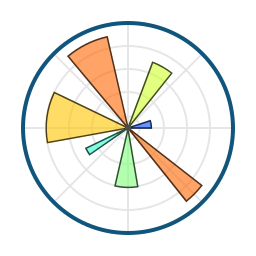
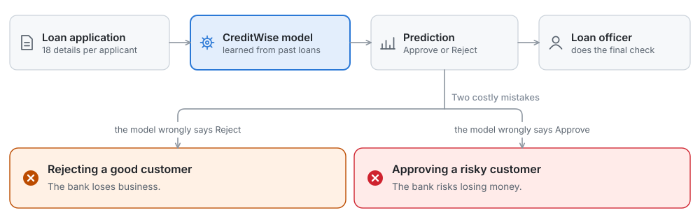
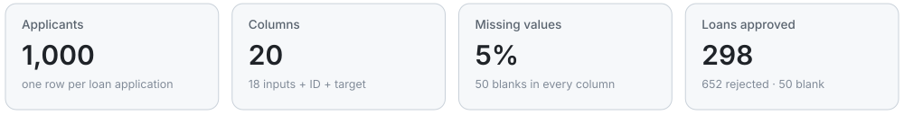
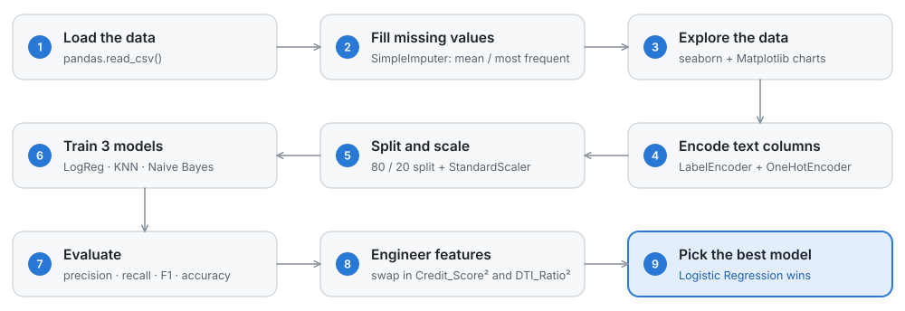
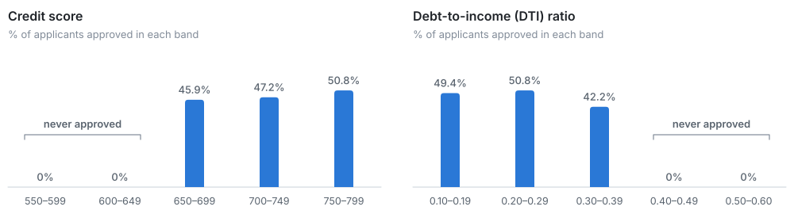
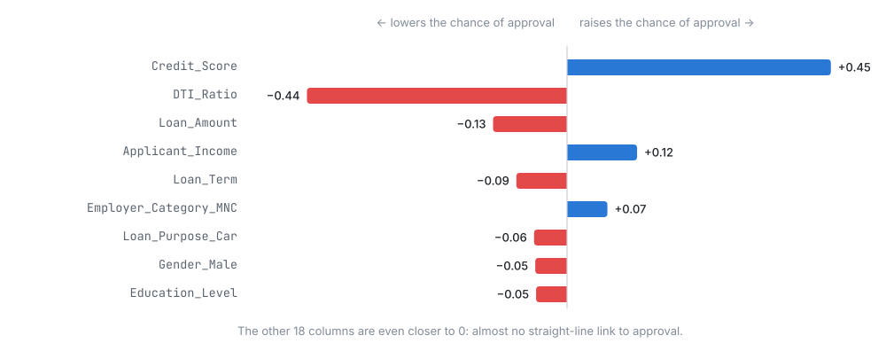
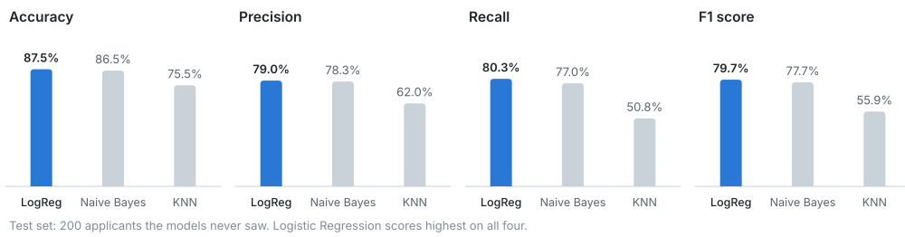
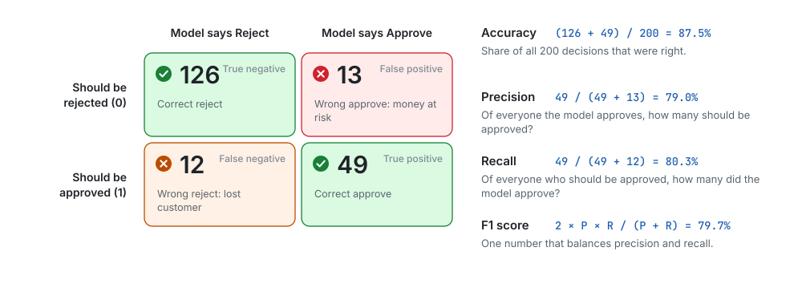

<div align="center">

# 🏦 CreditWise Loan System

**Should the bank approve this loan? A machine-learning model that answers *Approved* or *Rejected*.**

A beginner-friendly walkthrough of the whole project: the problem, the dataset,<br>
and every step of the solution with the code from [`credit_wise.ipynb`](credit_wise.ipynb) and its real results.

<table>
  <tr>
    <td align="center" width="104"><a href="https://www.python.org/"></a><br><b>Python</b><br><sub>language</sub></td>
    <td align="center" width="104"><a href="https://jupyter.org/"></a><br><b>Jupyter</b><br><sub>notebook</sub></td>
    <td align="center" width="104"><a href="https://pandas.pydata.org/"><picture><source media="(prefers-color-scheme: dark)" srcset="images/logos/pandas-dark.svg"></picture></a><br><b>pandas</b><br><sub>tables</sub></td>
    <td align="center" width="104"><a href="https://numpy.org/"></a><br><b>NumPy</b><br><sub>arrays</sub></td>
    <td align="center" width="104"><a href="https://matplotlib.org/"></a><br><b>Matplotlib</b><br><sub>charts</sub></td>
    <td align="center" width="104"><a href="https://seaborn.pydata.org/"><picture><source media="(prefers-color-scheme: dark)" srcset="images/logos/seaborn-dark.svg"></picture></a><br><b>seaborn</b><br><sub>stats charts</sub></td>
    <td align="center" width="104"><a href="https://scikit-learn.org/"><picture><source media="(prefers-color-scheme: dark)" srcset="images/logos/scikit-learn-dark.svg"></picture></a><br><b>scikit-learn</b><br><sub>models</sub></td>
  </tr>
</table>

</div>

---

## 📌 Contents

| Understand it | Build it | Learn from it |
|---|---|---|
| [🎯 The problem](#-the-problem) | [Step 1: Load the data](#step-1-load-the-data) | [🏆 Results](#-results) |
| [📊 The dataset](#-the-dataset) | [Step 2: Fill missing values](#step-2-fill-missing-values) | [💡 Key takeaways](#-key-takeaways) |
| [🧠 The plan](#-the-plan) | [Step 3: Explore the data](#step-3-explore-the-data) | [🧪 Practice ideas](#-practice-ideas) |
| | [Step 4: Turn text into numbers](#step-4-turn-text-into-numbers) | [🚀 Run it yourself](#-run-it-yourself) |
| | [Step 5: Find the important columns](#step-5-find-the-important-columns) | |
| | [Step 6: Split and scale](#step-6-split-and-scale) | |
| | [Step 7: Train three models](#step-7-train-three-models) | |
| | [Step 8: Engineer features](#step-8-engineer-features) | |

---

## 🎯 The problem

**SecureTrust Bank** is a mid-sized bank that gives personal and home loans to customers in cities and villages across India. Today, loan officers check every application **by hand**, which is slow, inconsistent (two officers can decide differently) and open to bias. A wrong decision costs the bank either way.

**The goal:** a model that learns from past loan decisions and predicts **Approved (1)** or **Rejected (0)** for each new application *before* the final human check, so that decisions are **accurate, fast and unbiased**:

<picture>
  <source media="(prefers-color-scheme: dark)" srcset="images/problem-dark.svg">
  
</picture>

> 🧩 In machine-learning words, this is **binary classification** (the answer is one of two classes) and **supervised learning** (we learn from examples where the right answer is already known).

## 📊 The dataset

[`loan_approval_data.csv`](loan_approval_data.csv) has one row per loan application:

<picture>
  <source media="(prefers-color-scheme: dark)" srcset="images/dataset-glance-dark.svg">
  
</picture>

| Column | What it means | Values in the data |
|---|---|---|
| `Applicant_ID` | Unique ID of the application | 1 to 1,000 (removed before training) |
| `Applicant_Income` | Applicant's monthly income | 2,009 to 19,988 |
| `Coapplicant_Income` | Co-applicant's monthly income | 1 to 9,996 |
| `Employment_Status` | Type of job | Salaried, Contract, Self-employed, Unemployed |
| `Age` | Age in years | 21 to 59 |
| `Marital_Status` | Married or not | Married, Single |
| `Dependents` | People who depend on the applicant | 0 to 3 |
| `Credit_Score` | Score from the credit bureau (higher = better repayment history) | 550 to 799 |
| `Existing_Loans` | Loans the applicant is already paying | 0 to 4 |
| `DTI_Ratio` | **Debt-to-income ratio**: monthly debt payments ÷ monthly income | 0.10 to 0.60 |
| `Savings` | Savings balance | 65 to 19,996 |
| `Collateral_Value` | Value of assets offered as security | 36 to 49,954 |
| `Loan_Amount` | Amount requested | 1,015 to 39,995 |
| `Loan_Term` | Length of the loan in months | 12 to 84 |
| `Loan_Purpose` | What the money is for | Business, Car, Home, Education, Personal |
| `Property_Area` | Where the applicant lives | Urban, Semiurban, Rural |
| `Education_Level` | Highest education | Graduate, Not Graduate |
| `Gender` | Gender | Male, Female |
| `Employer_Category` | Type of employer | Private, Government, MNC, Business, Unemployed |
| `Loan_Approved` | 🎯 **Target: what we predict** | Yes, No |

The values listed are the ones actually in the CSV (a few category names differ from the problem PDF).

## 🧠 The plan

<picture>
  <source media="(prefers-color-scheme: dark)" srcset="images/pipeline-dark.svg">
  
</picture>

---

## Step 1: Load the data

```python
import pandas as pd
import numpy as np
import seaborn as sns
import matplotlib.pyplot as plt
from sklearn.model_selection import train_test_split

df = pd.read_csv("loan_approval_data.csv")
print(df.shape)                          # (rows, columns)
print(df.isnull().sum().head(4))         # missing values in the first 4 columns
```

```text
(1000, 20)
Applicant_ID          50
Applicant_Income      50
Coapplicant_Income    50
Employment_Status     50
dtype: int64
```

Every one of the 20 columns has exactly **50 blanks** (5%). Machine-learning models can't work with blanks, so they have to be filled first.

## Step 2: Fill missing values

`SimpleImputer` fills the blanks: **numbers** get the column's **average** (mean), **text** gets the column's **most common value**.

```python
from sklearn.impute import SimpleImputer

categorical_cols = df.select_dtypes(include=["object"]).columns   # text columns
numerical_cols = df.select_dtypes(include=["number"]).columns     # number columns

num_imp = SimpleImputer(strategy="mean")
df[numerical_cols] = num_imp.fit_transform(df[numerical_cols])

cat_imp = SimpleImputer(strategy="most_frequent")
df[categorical_cols] = cat_imp.fit_transform(df[categorical_cols])

print(df.isnull().sum().sum())           # blanks left in the whole table
```

```text
0
```

> 💡 On **pandas 3** the `include=["object"]` line prints a `Pandas4Warning`. Writing `include=["object", "string"]` works without a warning on both pandas 2 and 3.

## Step 3: Explore the data

**How balanced are the answers?**

```python
print(df["Loan_Approved"].value_counts())
```

```text
Loan_Approved
No     702
Yes    298
Name: count, dtype: int64
```

About **70% No and 30% Yes**: the classes are **imbalanced**. Remember this: a lazy "model" that always says *No* would already be about 70% accurate, so real models must beat that.

The notebook then draws a pie chart, bar charts, histograms and box plots with Matplotlib and seaborn. The clearest finding is about **credit score** and **DTI ratio**:

<picture>
  <source media="(prefers-color-scheme: dark)" srcset="images/approval-by-band-dark.svg">
  
</picture>

🔑 **Nobody with a credit score below 650 was approved, and nobody with a DTI ratio of 0.40 or more was approved.** These two columns will matter most.

<details>
<summary><b>Code: the notebook's box plots, and the numbers behind the chart above</b></summary>

```python
fig, axes = plt.subplots(2, 2)

sns.boxplot(ax=axes[0, 0], data=df, x="Loan_Approved", y="Applicant_Income")
sns.boxplot(ax=axes[0, 1], data=df, x="Loan_Approved", y="Credit_Score")
sns.boxplot(ax=axes[1, 0], data=df, x="Loan_Approved", y="DTI_Ratio")
sns.boxplot(ax=axes[1, 1], data=df, x="Loan_Approved", y="Savings")

plt.tight_layout()
```

```python
approved = df["Loan_Approved"] == "Yes"
score_band = pd.cut(df["Credit_Score"], bins=[550, 600, 650, 700, 750, 800], right=False)
dti_band = pd.cut(df["DTI_Ratio"], bins=[0.1, 0.2, 0.3, 0.4, 0.5, 0.7], right=False)

print(approved.groupby(score_band, observed=True).mean().round(3))
print(approved.groupby(dti_band, observed=True).mean().round(3))
```

```text
Credit_Score
[550, 600)    0.000
[600, 650)    0.000
[650, 700)    0.459
[700, 750)    0.472
[750, 800)    0.508
Name: Loan_Approved, dtype: float64
DTI_Ratio
[0.1, 0.2)    0.494
[0.2, 0.3)    0.508
[0.3, 0.4)    0.422
[0.4, 0.5)    0.000
[0.5, 0.7)    0.000
Name: Loan_Approved, dtype: float64
```

</details>

## Step 4: Turn text into numbers

Models only understand numbers. First, `Applicant_ID` is dropped: an ID number says nothing about risk.

```python
df = df.drop("Applicant_ID", axis=1)
```

Then two kinds of encoding:

- **`LabelEncoder`** gives each category a number. Used for the two yes/no-style columns: `Education_Level` (Graduate → 0, Not Graduate → 1) and the target `Loan_Approved` (No → 0, Yes → 1).
- **`OneHotEncoder`** makes one 0/1 column per category. Used for the other text columns, where numbering (1, 2, 3…) would invent a fake order.

```python
from sklearn.preprocessing import LabelEncoder, OneHotEncoder

le = LabelEncoder()
df["Education_Level"] = le.fit_transform(df["Education_Level"])
df["Loan_Approved"] = le.fit_transform(df["Loan_Approved"])

cols = ["Employment_Status", "Marital_Status", "Loan_Purpose", "Property_Area", "Gender", "Employer_Category"]

ohe = OneHotEncoder(drop="first", sparse_output=False, handle_unknown="ignore")
encoded = ohe.fit_transform(df[cols])
encoded_df = pd.DataFrame(encoded, columns=ohe.get_feature_names_out(cols), index=df.index)

df = pd.concat([df.drop(columns=cols), encoded_df], axis=1)
print(df.shape)
```

```text
(1000, 28)
```

For example, `Property_Area` becomes two columns. `drop="first"` removes the first category (*Rural*) because it's already implied when the others are both 0:

| Property_Area | `Property_Area_Semiurban` | `Property_Area_Urban` |
|---|:---:|:---:|
| Rural | 0 | 0 |
| Semiurban | 1 | 0 |
| Urban | 0 | 1 |

## Step 5: Find the important columns

**Correlation** measures how two columns move together, from −1 to +1. The notebook draws a heatmap of all of them and lists each column's correlation with `Loan_Approved`:

```python
num_cols = df.select_dtypes(include="number")
corr_matrix = num_cols.corr()

plt.figure(figsize=(15, 8))
sns.heatmap(corr_matrix, annot=True, fmt=".2f", cmap="coolwarm")

num_cols.corr()["Loan_Approved"].sort_values(ascending=False)
```

<picture>
  <source media="(prefers-color-scheme: dark)" srcset="images/correlation-dark.svg">
  
</picture>

Same story as the charts: a **higher credit score** helps, a **higher DTI ratio** hurts, and a bigger loan amount hurts a little.

## Step 6: Split and scale

The model must be tested on applications it has **never seen**, so 20% of the rows are kept aside as a test set:

```python
X = df.drop("Loan_Approved", axis=1)   # the 27 input columns
y = df["Loan_Approved"]                # the answer: 0 or 1

X_train, X_test, y_train, y_test = train_test_split(X, y, test_size=0.2, random_state=42)
print(X_train.shape, X_test.shape)
```

```text
(800, 27) (200, 27)
```

Columns live on very different scales (income in thousands, DTI below 1). `StandardScaler` rescales every column to mean 0 and standard deviation 1, so no column wins just because its numbers are bigger:

```python
from sklearn.preprocessing import StandardScaler

scaler = StandardScaler()
X_train_scaled = scaler.fit_transform(X_train)   # learn mean and std from the TRAINING rows only
X_test_scaled = scaler.transform(X_test)         # reuse them on the test rows (no peeking!)
```

## Step 7: Train three models

| Model | How it decides, in one line |
|---|---|
| **Logistic Regression** | Gives every column a weight, adds them up and turns the total into a probability of approval |
| **K-Nearest Neighbors** (k = 5) | Finds the 5 most similar past applicants and copies their majority decision |
| **Gaussian Naive Bayes** | Uses probability rules, assuming each column affects the answer independently |

Each model is trained on the 800 training rows and scored on the 200 test rows. Here is the Logistic Regression cell; the notebook repeats it for the other two, changing only the model line:

```python
from sklearn.linear_model import LogisticRegression
from sklearn.metrics import confusion_matrix, accuracy_score, precision_score, recall_score, f1_score

log_model = LogisticRegression()
log_model.fit(X_train_scaled, y_train)

y_pred = log_model.predict(X_test_scaled)

print("Precision: ", precision_score(y_test, y_pred))
print("Recall: ", recall_score(y_test, y_pred))
print("F1 score: ", f1_score(y_test, y_pred))
print("Accuracy: ", accuracy_score(y_test, y_pred))
print("CM: ", confusion_matrix(y_test, y_pred))
```

```text
Precision:  0.7833333333333333
Recall:  0.7704918032786885
F1 score:  0.7768595041322314
Accuracy:  0.865
CM:  [[126  13]
 [ 14  47]]
```

The other two use `KNeighborsClassifier(n_neighbors=5)` and `GaussianNB()`. All three on the test set:

| Model | Accuracy | Precision | Recall | F1 score |
|---|---:|---:|---:|---:|
| Logistic Regression | **86.5%** | 78.3% | **77.0%** | **77.7%** |
| KNN (k = 5) | 76.0% | 62.7% | 52.5% | 57.1% |
| Naive Bayes | **86.5%** | **80.4%** | 73.8% | 76.9% |

**What do these scores mean for the bank?** Each one guards against one of the two costly mistakes from the problem:

| Score | The question it answers | Low score means… |
|---|---|---|
| **Accuracy** | How many decisions were right overall? | many wrong decisions |
| **Precision** | Of the applicants the model **approves**, how many should be approved? | risky customers get approved: **money lost** |
| **Recall** | Of the applicants who **should be approved**, how many does the model approve? | good customers get rejected: **business lost** |
| **F1 score** | A single score that balances precision and recall | one of the two is weak |

At this stage the notebook picks **Naive Bayes**, because it has the best precision (fewest risky approvals).

## Step 8: Engineer features

**Feature engineering** means creating better input columns from the ones you have. The notebook replaces the two most important columns with their **squares** (the `Applicant_Income_log` line is left commented out):

```python
# Add or transform features
df["DTI_Ratio_sq"] = df["DTI_Ratio"] ** 2
df["Credit_Score_sq"] = df["Credit_Score"] ** 2

# df["Applicant_Income_log"] = np.log1p(df["Applicant_Income"])

X = df.drop(columns=["Loan_Approved", "Credit_Score", "DTI_Ratio"])
y = df["Loan_Approved"]

# Same split and scaling as before
X_train, X_test, y_train, y_test = train_test_split(X, y, test_size=0.2, random_state=42)

scaler = StandardScaler()
X_train_scaled = scaler.fit_transform(X_train)
X_test_scaled = scaler.transform(X_test)
```

Then the same three model cells run again. Logistic Regression now gives:

```python
log_model = LogisticRegression()
log_model.fit(X_train_scaled, y_train)
y_pred = log_model.predict(X_test_scaled)

print("Accuracy: ", accuracy_score(y_test, y_pred))
print("CM: ", confusion_matrix(y_test, y_pred))
```

```text
Accuracy:  0.875
CM:  [[126  13]
 [ 12  49]]
```

| Model | Accuracy | Precision | Recall | F1 score |
|---|---:|---:|---:|---:|
| **Logistic Regression** | **87.5%** (+1.0) | **79.0%** (+0.7) | **80.3%** (+3.3) | **79.7%** (+2.0) |
| KNN (k = 5) | 75.5% (−0.5) | 62.0% (−0.7) | 50.8% (−1.7) | 55.9% (−1.2) |
| Naive Bayes | 86.5% (±0) | 78.3% (−2.1) | 77.0% (+3.2) | 77.7% (+0.8) |

<sub>In brackets: change from Step 7, in percentage points.</sub>

Logistic Regression improves on every score. The gain is small, though: **2 more correct decisions out of 200**.

---

## 🏆 Results

<picture>
  <source media="(prefers-color-scheme: dark)" srcset="images/model-results-dark.svg">
  
</picture>

**Winner: Logistic Regression with the engineered features.** Here is what it did with the 200 test applicants it had never seen:

<picture>
  <source media="(prefers-color-scheme: dark)" srcset="images/confusion-matrix-dark.svg">
  
</picture>

- ✅ **175 of 200** decisions were right (87.5%), well above the 69.5% that "always reject" would score on this test set.
- ⚠️ **13 risky applicants** would have been approved, and **12 good applicants** rejected. That's why a loan officer still makes the final check.

## 💡 Key takeaways

1. **Explore before you model.** Two simple rules (credit score ≥ 650 and DTI ratio < 0.40) explain most of the decisions.
2. **Check the baseline.** With 70% "No" answers, 70% accuracy is worthless; compare every model with the "always No" score.
3. **Pick the metric that matches the cost.** Precision protects the bank's money; recall protects its customers.
4. **Scale before distance-based models.** KNN measures distances, so unscaled income would drown out everything else. Even scaled, it was the weakest model here.
5. **Fit on training data only.** The scaler learns from the training rows and is then reused on the test rows.

## 🧪 Practice ideas

Try these on your own copy of the notebook:

1. **Split first, then fill blanks.** Here the imputers see all 1,000 rows, test rows included. Fit them on `X_train` only (a `Pipeline` makes this easy).
2. **Don't guess the answer.** The 50 blank `Loan_Approved` values were filled with "No". Drop those rows instead and train again.
3. **Try a decision tree.** `DecisionTreeClassifier(max_depth=3, random_state=42)` can learn rules like "credit score ≥ 650" directly. Does it beat Logistic Regression?
4. **Use cross-validation.** One test set of 200 rows is small: a difference of 2 decisions can be luck. `cross_val_score(model, X, y, cv=5)` gives a steadier comparison.
5. **Check fairness.** The bank wants unbiased decisions. Train without `Gender` and `Marital_Status` and compare the scores.
6. **Handle the imbalance.** Add `stratify=y` to `train_test_split`, or try `LogisticRegression(class_weight="balanced")`, and watch what happens to recall.

## 🚀 Run it yourself

```bash
git clone https://github.com/Preetbbhalala/Credit-Wise-Loan-System.git
cd Credit-Wise-Loan-System
pip install pandas numpy matplotlib seaborn scikit-learn jupyter
jupyter notebook credit_wise.ipynb
```

Then choose **Run → Run All Cells**. The results above come from a fresh top-to-bottom run (tested with Python 3.13, pandas 2.3 and 3.1, scikit-learn 1.9).

| File | What's inside |
|---|---|
| [`credit_wise.ipynb`](credit_wise.ipynb) | the full solution: cleaning, charts, encoding, models and scores |
| [`loan_approval_data.csv`](loan_approval_data.csv) | the dataset: 1,000 loan applications × 20 columns |
| [`CreditWise Loan System.pdf`](CreditWise%20Loan%20System.pdf) | the original problem statement and data dictionary |
| [`images/`](images) | the logos and diagrams in this README |

---

## 👤 Author

**Preet Bhalala**: [@Preetbbhalala](https://github.com/Preetbbhalala)

⭐ If this helped you learn machine learning, please give the repo a star!
